# Me Conta · App

> O app que troca o 👍 da família por uma pergunta que só os avós sabem responder.

App mobile do **Me Conta**, desenvolvido para a Global Solution FIAP 2026 (CitizenTech). Feito em **React Native + Expo + TypeScript + Expo Router**, com banco local **SQLite**, ele consome a [API do Me Conta](https://github.com/Nicoli-Kassa/GS_CitizenTech_API_MeConta) ou, sem servidor, um modo de demonstração com as mesmas regras.

O app é um caderno de família. Cada resposta em áudio dos avós vira uma página, e as páginas viram com o dedo.

| | |
|---|---|
| 🎬 **Vídeo do app (até 3 min)** | [Assistir no YouTube](https://youtu.be/INSERIR-LINK-DO-VIDEO-MOBILE) |
| 🎤 **Pitch (até 4 min)** | [Assistir no YouTube](https://youtu.be/F_s7jXz_GzU?si=BWAwcYsnbfSadE9d) |
| 🔌 **API (C# / .NET)** | [GS_CitizenTech_API_MeConta](https://github.com/Nicoli-Kassa/GS_CitizenTech_API_MeConta) | 

---

## Ficha da CitizenTech

| Campo | Resposta |
|---|---|
| **Nome da CitizenTech** | Me Conta |
| **Cidade e bairro** | São Paulo (SP). Bairro piloto: Pirituba, zona norte |
| **Cidadão beneficiado** | Pessoas idosas, com mais de 60 anos, especialmente as que moram sozinhas, e seus netos e filhos. Pelo modo "Ensine sua avó", também os idosos que ainda não usam o celular. |
| **Problema em uma frase** | Os avós guardam receitas, histórias da família e memórias do bairro que ninguém mais tem, mas, quando mandam um "bom dia" no grupo da família, recebem de volta um 👍 e nenhuma pergunta. |
| **A solução** | O Me Conta é um aplicativo que troca o 👍 da família por uma pergunta que só os avós sabem responder. |
| **Como funciona** | O neto escolhe uma pergunta no app (receitas, história da família, ofícios, o bairro, conselhos). O app abre o WhatsApp com a mensagem pronta. O avô responde por áudio, do jeito que já sabe. A resposta vira uma memória e vai para a página do caderno da família, com áudio, foto e título. O idoso volta a ser quem ensina e lembra. |
| **Link do repositório** | https://github.com/Nicoli-Kassa/GS_CitizenTech_Mobile_MeConta |
| **Indicador de impacto** | Conversas de verdade por semana: % de idosos que respondem pelo menos uma pergunta da família por semana. Indicadores de apoio: minutos de áudio guardados no caderno de cada família e % de idosos que passam a responder sem ajuda depois do modo "Ensine sua avó". |
| **ODS conectados** | **ODS 10**, meta 10.2 (inclusão social de todos, independentemente da idade) · **ODS 11**, meta 11.4 (proteger o patrimônio cultural, aqui a memória do bairro) · **ODS 3**, meta 3.4 (bem-estar mental, pelo vínculo e não por cuidado de saúde) |

### O papel do app no Me Conta

O app é por onde a família usa o Me Conta. A neta escolhe a pergunta e manda pelo WhatsApp. Depois guarda o áudio da resposta e monta o caderno da família. O caderno funciona sem internet, e a jornada inteira foi pensada para quem tem pouca prática com o celular.

---

## Integrantes

| Nome | RM |
|---|---|
| Nicoli Amy Kassa | RM-INSERIR |

---

## O que o app faz

A jornada principal, do começo ao fim:

1. **Entrar ou criar conta** com e-mail e senha. Depois, **escrever o nome da família na capa** do caderno, ou entrar no caderno de um parente com o **código de convite**.
2. **Abrir o caderno.** A capa abre com uma animação, e as folhas viram com o dedo ou com as setas. As abas coloridas separam as memórias por assunto.
3. **Perguntar.** A pergunta da semana aparece num bilhete. Dá para sortear outra, escolher por assunto ou escrever uma pergunta da família.
4. **Enviar pelo WhatsApp.** O bilhete vira envelope e o WhatsApp abre com "Vó Laura, me conta: …" pronto para enviar.
5. **A página espera a resposta.** No caderno, aparece uma página em branco com a pergunta escrita no alto.
6. **Guardar a resposta.** A família escolhe o áudio que a avó mandou, uma foto, o título e, se quiser, escreve o que ela contou. A página é colada no caderno.
7. **Ouvir.** Cada página tem o botão "Ouvir", com a voz de quem contou.

E, além da jornada principal:

- **Sem internet**, o caderno abre, as perguntas aparecem e as respostas ficam guardadas como "Aguardando envio". Quando a conexão volta, tudo sobe sozinho, sem duplicar.
- **Porta-retrato (IoT):** quando a avó aperta "quero contar" no porta-retrato, um bilhete aparece no alto do caderno.
- **Caderno do bairro:** com a autorização da avó, uma memória pode ir para o caderno de Pirituba. Antes, o filtro de dados pessoais da API confere o texto e a IA explica o risco em linguagem simples.
- **Nossa família:** os avós cadastrados, o painel "Conversas de verdade", o convite e o roteiro "Ensine sua avó".

### Requisitos da matéria

| Critério | Onde está |
|---|---|
| **Telas e navegação** | 10 rotas do Expo Router em `src/app/` (só pilha, sem abas). O caderno é a tela inicial e as outras telas sobem por cima dele como folhas soltas. |
| **Consumo de dados** | `src/services/api/apiHttp.ts` consome a API C# (`/api/v1`), com token Bearer, renovação automática do token, upload multipart do áudio e erros no formato ProblemDetails. Sem servidor, `apiMock.ts` segue o mesmo contrato (`contrato.ts`). |
| **Banco** | SQLite (`expo-sqlite`) em `src/services/banco/`, com migrações por `PRAGMA user_version`. Guarda o catálogo, os idosos, os envios, as páginas e a fila de sincronização (`src/services/sincronizacao.ts`). |
| **Acessibilidade** | Seção [Acessibilidade](#acessibilidade). |
| **Aderência ao problema** | O app resolve a jornada da Ficha: perguntar → WhatsApp → áudio → caderno, com o idoso no papel de quem ensina. |
| **Documentação** | Este README, os prints em `docs/prints/` e o [prompts.md](prompts.md). |

### Histórias do backlog atendidas

| PBI | O que o app faz |
|---|---|
| US01 Criar a família | Escrever o nome na capa (até 60 caracteres, com as mensagens da API). |
| US02 Cadastrar o idoso | Só nome, apelido e WhatsApp; a API normaliza o número e recusa número repetido. |
| US03 Convite | Gerar o código de 6 caracteres (48 h), mandar pelo compartilhamento do celular e entrar com ele. |
| US04 Perguntas por assunto | Catálogo salvo no SQLite, com a marca "Já perguntada". Funciona sem internet. |
| US05 Pergunta da semana | Mesmo cálculo da API: nunca repete, muda toda segunda-feira e é diferente para cada idoso. |
| US06 Pergunta própria | De 10 a 200 caracteres, com assunto, e com o filtro contra pedidos de dinheiro, PIX, senha ou código. |
| US07 Enviar pelo WhatsApp | Só registra o envio se o WhatsApp abrir. Sem WhatsApp, oferece copiar a pergunta. Idoso sem número: botão desativado com "Cadastre o WhatsApp". |
| US08 Guardar a resposta | mp3, m4a, ogg ou opus de até 20 MB; foto opcional; título em branco vira a pergunta. |
| US09 Ver e ouvir | Páginas da mais recente para a mais antiga, abas por assunto, botão "Ouvir" e caderno vazio com "Faça a primeira pergunta". |
| US10 Sem internet | SQLite + fila de envio com chave de idempotência. |
| US11 Apagar | Só quem guardou a página vê a opção, com confirmação. |
| US12 Painel | "Conversas de verdade" da semana e minutos de áudio. |
| US13 Acessível | WCAG 2.1 AA (veja abaixo). |
| US14 Ensine sua avó | Roteiro de 4 passos com "Conseguiu" e "Ainda não". |
| US15 Porta-retrato | Aviso "quero contar" no caderno e na família, e o estado do porta-retrato de cada avó. |
| US16 e US17 Bairro | Publicar com autorização, tirar do mapa e ouvir as memórias do bairro. |
| US18 Dados pessoais | Análise do filtro, explicação da IA e versão sem os dados. |

---

## Tecnologias

| Tecnologia | Versão | Para quê |
|---|---|---|
| Expo SDK | 58 | Base do app; roda no Expo Go |
| React Native | 0.88 | Interface nativa |
| React | 19.3 | Componentes |
| TypeScript | 6.0 (`strict`) | Tipos em todo o código, sem `any` |
| Expo Router | 58 | Navegação por arquivos em `src/app/` |
| expo-sqlite | 58 | Banco local e funcionamento sem internet |
| react-native-reanimated | 4.7 | Animações (capa, virar página, envelope) |
| react-native-gesture-handler | 3.3 | Gesto de virar a página |
| expo-audio | 58 | Ouvir os áudios e medir a duração |
| expo-document-picker / expo-image-picker | 58 | Escolher o áudio e a foto |
| expo-file-system | 58 | Guardar áudios e fotos na pasta do app |
| expo-secure-store | 58 | Guardar a sessão (Keychain / Keystore) |
| expo-network | 58 | Sincronizar quando a internet volta |
| expo-haptics | 58 | Vibração leve ao virar a página |
| react-native-svg | 15 | Ícones, ilustrações e enfeites desenhados para o app |
| @expo-google-fonts (Caveat, Lora, Special Elite) | — | Letra manuscrita, de livro e de máquina de escrever |

---

## Como rodar

**Pré-requisitos:** Node.js 20 ou mais novo e o app **Expo Go** atualizado no celular (SDK 58).

```bash
npm install
npm run start:clean
```

Escaneie o QR code com o Expo Go, com o celular na mesma rede Wi-Fi do PC. Se a rede bloquear a conexão, use `npx expo start --tunnel`.

### Modo de demonstração (sem API)

Sem configurar nada, o app usa os **dados de demonstração**. Na tela de entrada, toque em **"Entrar como Nicoli (demonstração)"** (`nicoli@example.com` / `MeConta@2026`).

A família de demonstração é a Família Souza: a Nicoli (neta), a Vó Laura e o Vô Antônio. Telefones, e-mails e histórias são **fictícios**. Esse modo segue as mesmas regras e mensagens da API e guarda tudo no SQLite do celular. O filtro de dados pessoais desse modo é uma versão reduzida do motor da API, com 6 tipos de dado em vez de 17 e sem a IA.

### Com a API

1. Suba a API no PC com o perfil de rede local, com as páginas de demonstração do filtro:
   ```powershell
   dotnet run --project src/MeConta.Api --launch-profile rede-local -- --Banco:PaginasDoFiltroDePrivacidade=true
   ```
2. Descubra o IP do PC (`ipconfig` → "Endereço IPv4").
3. Copie `.env.example` para `.env` e preencha:
   ```
   EXPO_PUBLIC_API_URL=http://192.168.0.10:5080
   ```
4. Libere a porta 5080 no Firewall do Windows, se o celular não conectar.
5. Rode `npm run start:clean` de novo e toque em **"Entrar com a conta de demonstração"**: o app usa a conta que a API cria no primeiro uso (`bia@example.com` / `MeConta@2026`). Os nomes que aparecem nas telas vêm da API.

Com a API ligada, a explicação de risco vem do Gemini (se a chave estiver configurada) e os avisos "quero contar" chegam do porta-retrato (Wokwi + Node-RED).

### Scripts

| Script | O que faz |
|---|---|
| `npm run start:clean` | Sobe o Metro limpando o cache, com mais memória |
| `npm run typecheck` | Confere os tipos (`tsc --noEmit`) |
| `npm run lint` | Lint do Expo (com as regras do React Compiler) |
| `npm run web` | Versão web, só para pré-visualizar |

---

## Telas

| Rota | Tela | O que tem |
|---|---|---|
| `entrar` | Entrar | Capa de tecido com e-mail, senha e a conta de demonstração |
| `cadastro` | Criar conta | Nome, e-mail e senha (com a regra da senha explicada antes de enviar) |
| `index` | Caderno da família | Capa que abre, folhas que viram, abas por assunto, aviso do porta-retrato, "Perguntar" e "Família". Sem família: boas-vindas para criar o caderno ou entrar com convite |
| `perguntar` | Perguntar | Para quem, pergunta da semana, outra pergunta, prévia da mensagem, por assunto, escrever a minha, envio pelo WhatsApp |
| `resposta/[envioId]` | Guardar a resposta | Áudio (com player e duração), foto, título e o que foi contado |
| `pagina/[chave]` | Página aberta | Ouvir, escrever o que foi contado, levar ao bairro (filtro + IA), apagar |
| `familia` | Nossa família | Avós, porta-retrato, painel, convite, bairro, conta |
| `ensine/[idosoId]` | Ensine sua avó | 4 passos desenhados, com "Conseguiu" e "Ainda não" |
| `bairro` | Caderno do bairro | Memórias publicadas, com áudio, para qualquer morador |

---

## Funcionamento sem internet

As telas sempre leem do SQLite. A sincronização (`src/services/sincronizacao.ts`) roda ao abrir o app, depois de cada gravação e quando a conexão volta (`expo-network`). Ela segue esta ordem:

1. **Envios feitos sem internet** sobem primeiro. Eles têm id negativo até a API responder, e as páginas ligadas a eles recebem o id novo.
2. **Respostas guardadas** sobem como multipart, sempre com a mesma **chave de idempotência**. Se a conexão cair no meio e o app reenviar, a API devolve a página que já existe e não duplica.
3. **Páginas apagadas** vão para a API e só então saem do celular.
4. Depois, o app baixa família, idosos, perguntas, envios e páginas, e copia os áudios e as fotos para a pasta do app.

---

## Acessibilidade

O app segue a **WCAG 2.1 nível AA** (US13 e RNF05):

- **Contraste:** todos os pares de texto e fundo foram medidos e passam de 4,5:1. Tinta sobre papel dá 11,3:1, e o texto secundário dá 8,3:1 no papel e 5,1:1 no kraft. Os valores estão comentados em `src/theme/theme.ts`.
- **Área de toque:** mínimo de 48 dp. Os botões principais têm 56 dp.
- **Botões sempre com texto.** Ícone sozinho é o que mais trava quem tem pouca prática com o celular, por isso os botões redondos do canto também têm texto.
- **Todo gesto tem botão.** As setas viram a página com a mesma animação, e o leitor de tela anuncia "Página 2 de 7".
- **Leitor de tela:** `accessibilityRole`, `accessibilityLabel`, `accessibilityHint` e `accessibilityState` em botões, abas, caixas de marcar e escolhas. Os enfeites (fita, cantoneiras, argolas) ficam escondidos do leitor com `aria-hidden`.
- **Reduzir movimento:** com a opção ligada no celular, a capa e as folhas trocam com um esmaecimento, sem giro.
- **Fonte do sistema até 200%:** nenhum texto tem altura fixa e as linhas quebram. A letra manuscrita aparece só em títulos grandes; o texto de leitura usa uma fonte de livro, a partir de 17 pt.
- **Erros escritos por extenso**, com ícone, e não só com cor. O leitor de tela anuncia o erro.

---

## Integração com as outras matérias

| Matéria | Como aparece no app |
|---|---|
| **C# e SOA** | Toda a comunicação usa as rotas `/api/v1` da API, com os mesmos nomes dos DTOs (`src/types/api.ts`). |
| **IoT** | O porta-retrato chama `POST /porta-retrato/quero-contar`, e o app consulta `GET /familias/{id}/avisos` a cada 15 s e mostra o bilhete "Vó Laura quer contar!". Em "Nossa família", aparece se o porta-retrato está ligado. |
| **Cybersecurity** | Antes de publicar no bairro, o app chama `POST /paginas/{id}/analise-privacidade` e `GET /paginas/{id}/explicacao-de-risco`. Mostra o índice Risco Cidadão, os trechos mascarados, o alerta da IA e a versão sem os dados (`PUT /paginas/{id}/transcricao`). |

---

## Estrutura

```
me-conta-app/
├── app.json, metro.config.js, tsconfig.json, .env.example
├── assets/
│   ├── texturas/        papel, kraft, tecido da capa e mesa (geradas para o projeto)
│   └── demo/            melodia de 20 s gerada para as páginas de demonstração
├── docs/prints/         prints das telas
└── src/
    ├── app/             rotas do Expo Router (telas)
    ├── components/      Botao, Campo, Folha, Recado, Escolha, PlayerDeAudio...
    │   └── caderno/     Caderno (virar página), Capa, Argolas, Abas, folhas
    ├── config/          URL da API e conta de demonstração
    ├── contexts/        SessaoContext (login, perfil, família, sincronização)
    ├── hooks/           useCaderno, usePerguntas, useAvisos, useMovimentoReduzido
    ├── services/
    │   ├── api/         contrato, ApiHttp, ApiMock, parsers, catálogo, motor de demonstração
    │   ├── banco/       SQLite: migrações e repositórios
    │   └── sincronizacao.ts, tokenStorage.ts, eventos.ts
    ├── theme/           cores, fontes, espaçamentos e texturas
    ├── types/           tipos da API e do caderno
    └── utils/           erros, leitura segura de dados, regras de negócio, arquivos
```

---

## Prints

| | | |
|---|---|---|
| 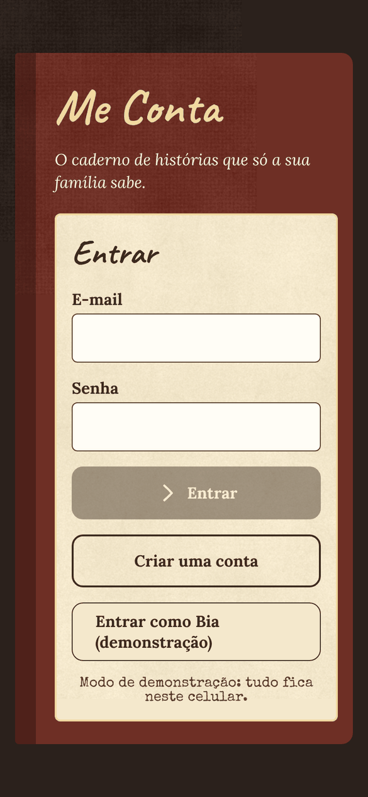 | 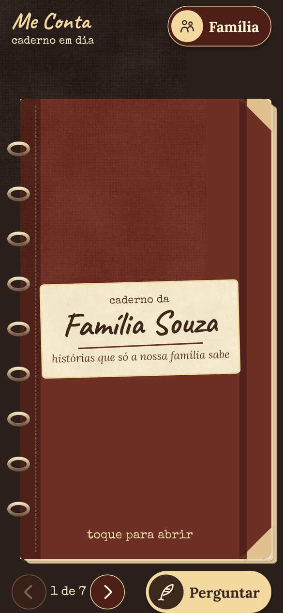 | 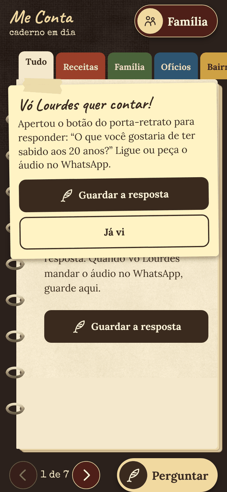 |
| Entrar | Capa do caderno | "Vó Laura quer contar!" (porta-retrato) |
| 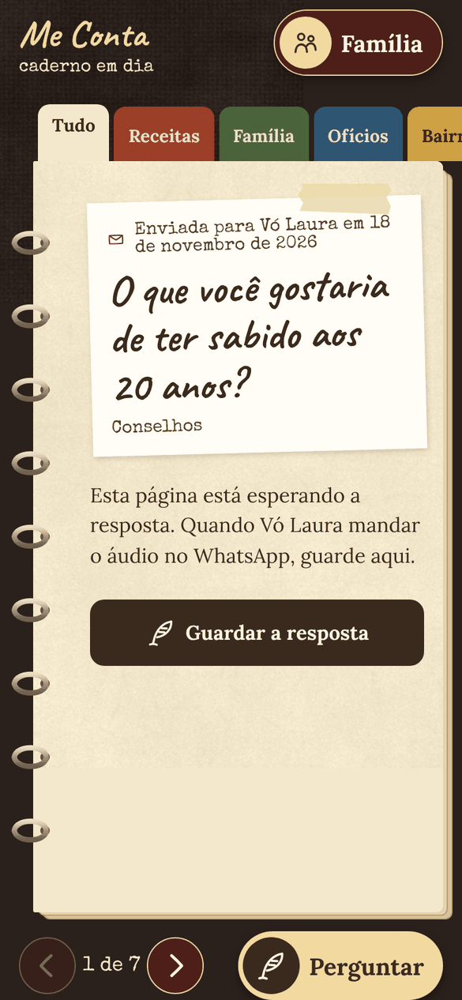 | 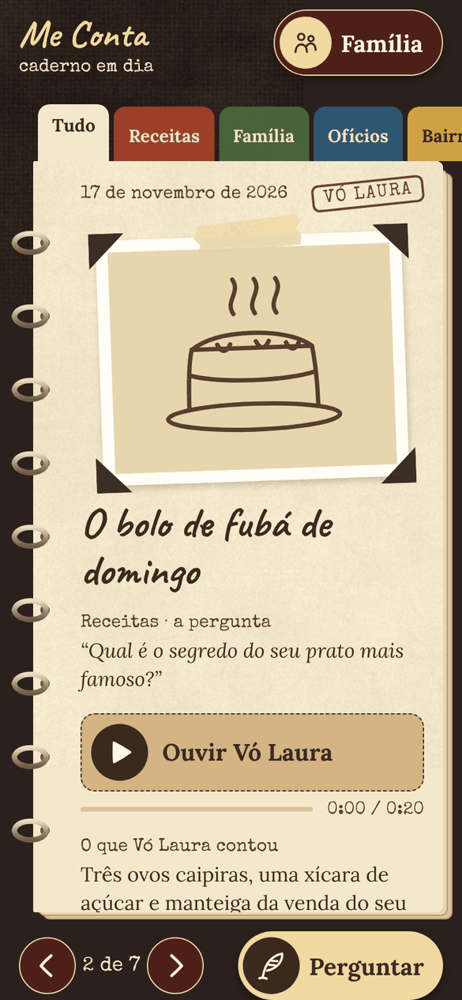 | 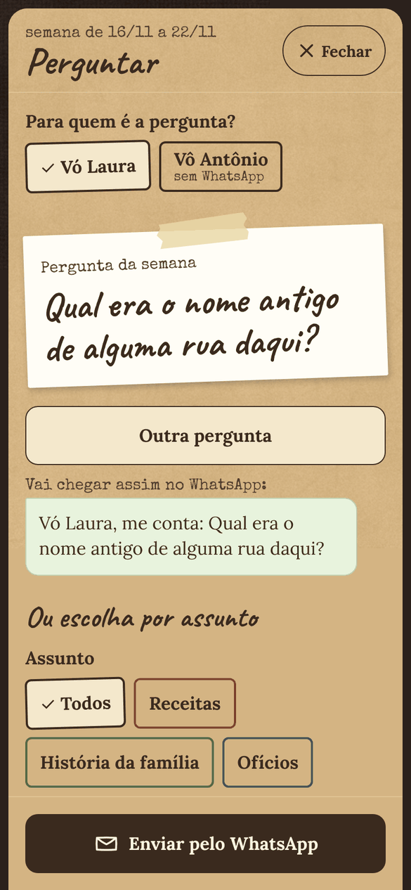 |
| Página esperando a resposta | Memória com áudio | Pergunta da semana |
| 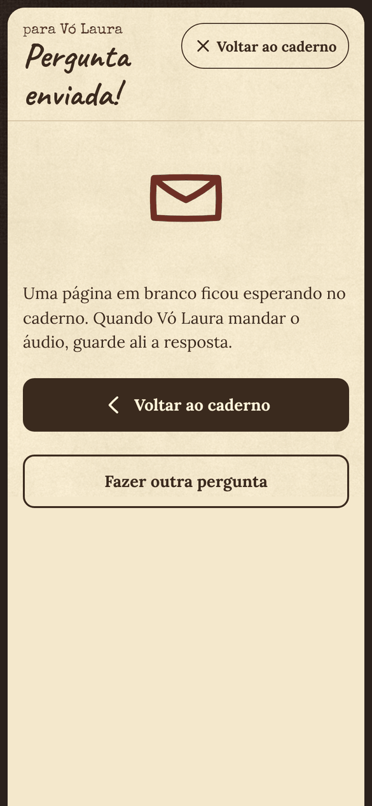 | 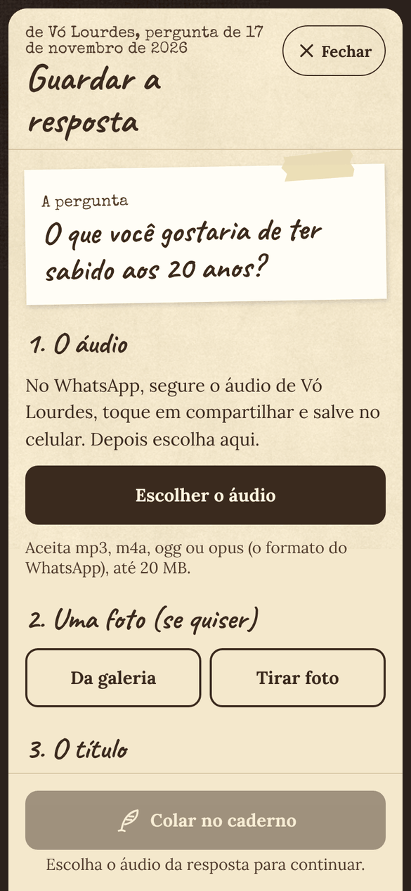 | 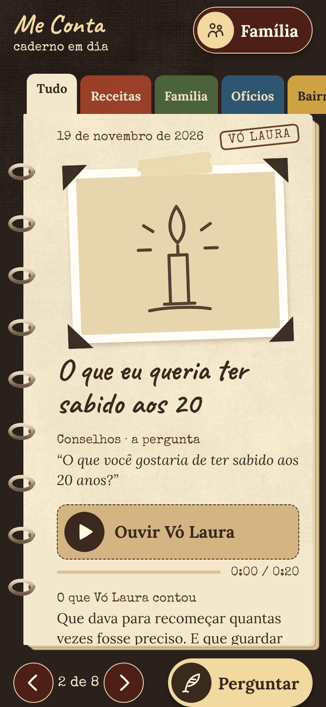 |
| Pergunta enviada | Guardar a resposta | A resposta colada no caderno |
| 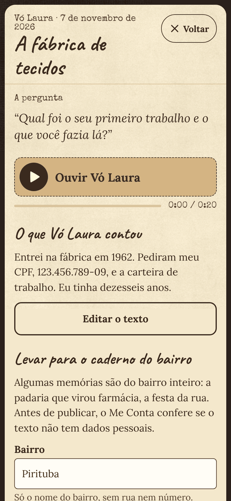 | 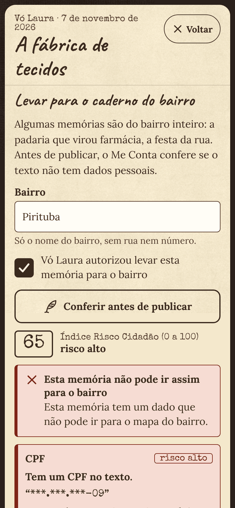 | 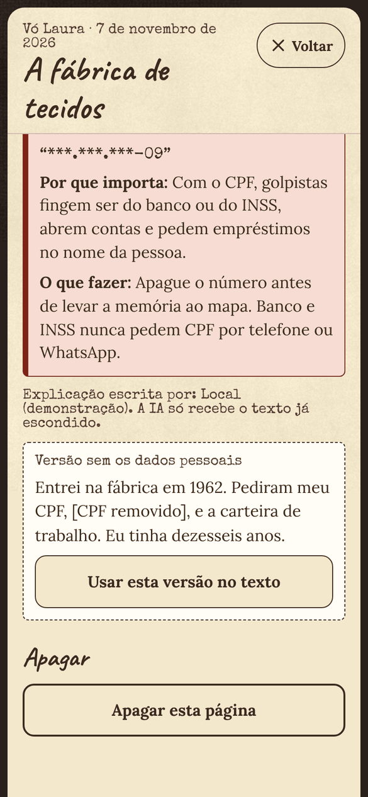 |
| Página aberta | CPF encontrado: publicação barrada | Explicação e versão sem os dados |
| 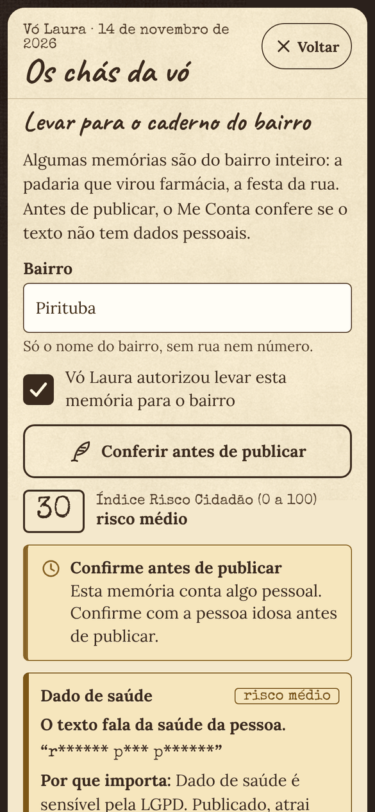 | 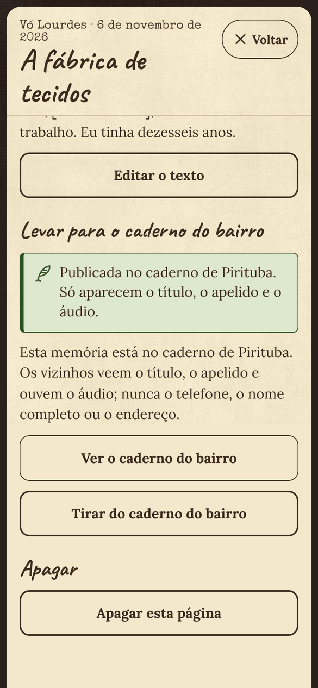 | 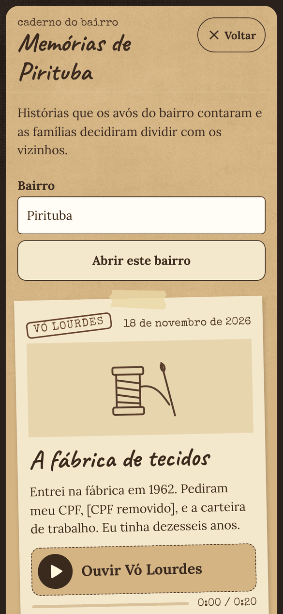 |
| Dado de saúde: pede confirmação | Publicada em Pirituba | Caderno do bairro |
| 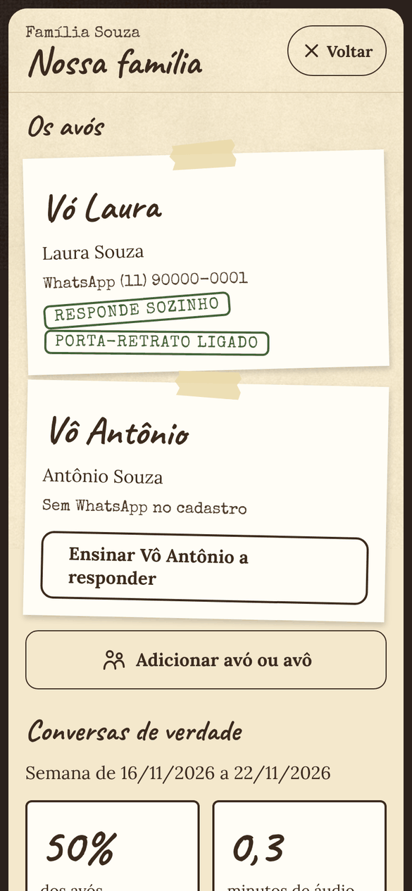 | 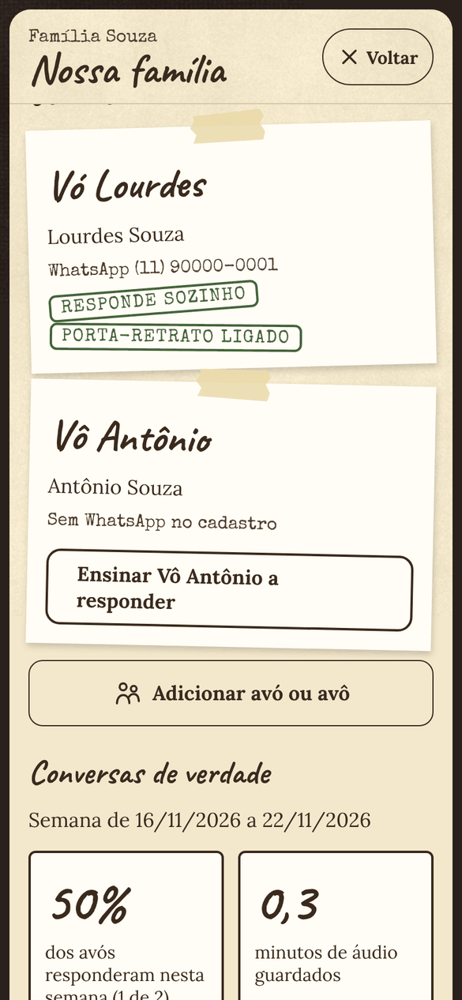 | 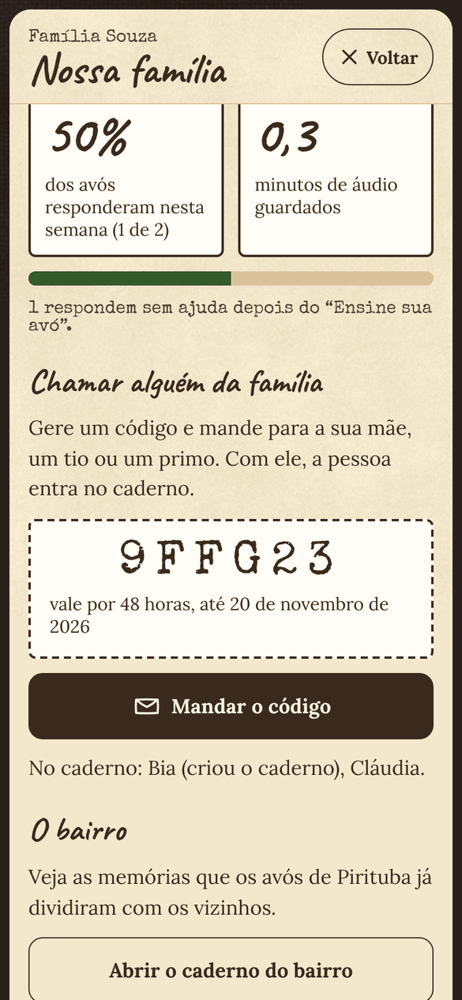 |
| Nossa família | Painel "Conversas de verdade" | Código de convite |
| 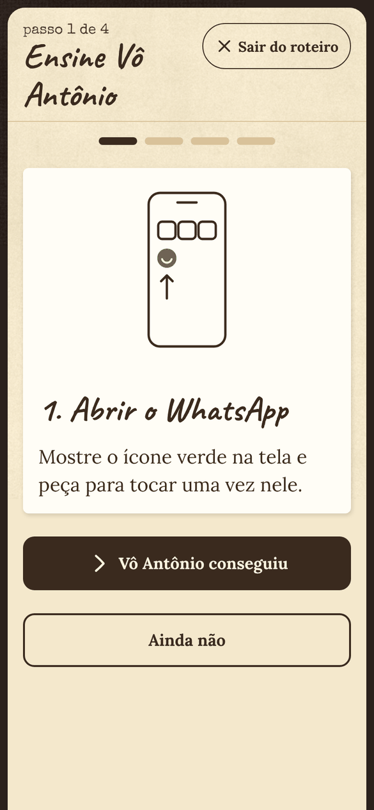 | 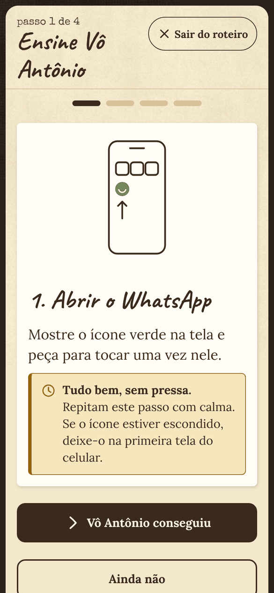 | |
| Ensine sua avó | "Ainda não": repetir o passo | |

> Prints do modo de demonstração, na pré-visualização web em tamanho de celular. Telefones e histórias são fictícios.

---

## Limitações e próximos passos

- **Áudio pelo "Compartilhar" do WhatsApp:** receber o áudio direto do WhatsApp exige um build próprio do app (intent filter / share extension). No Expo Go, a família salva o áudio no celular e escolhe o arquivo no app.
- **iPhone e .opus:** o iOS não toca áudios `.opus` / `.ogg`, que é o formato do WhatsApp. A página é guardada normalmente, mas, se o iPhone não conseguir ler o arquivo, a duração aparece como "aproximada".
- **Transcrição:** quem escreve o que foi contado é a família. O próximo passo é a transcrição automática do áudio.
- **Avisos do porta-retrato:** o app pergunta à API a cada 15 s. Num app publicado, isso viraria notificação push.
- **Mapa:** o caderno do bairro é uma lista por bairro. O mapa com marcadores fica para depois do piloto em Pirituba.

---
 
